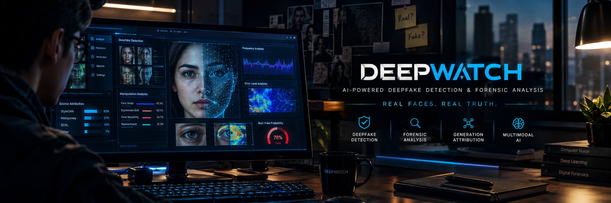
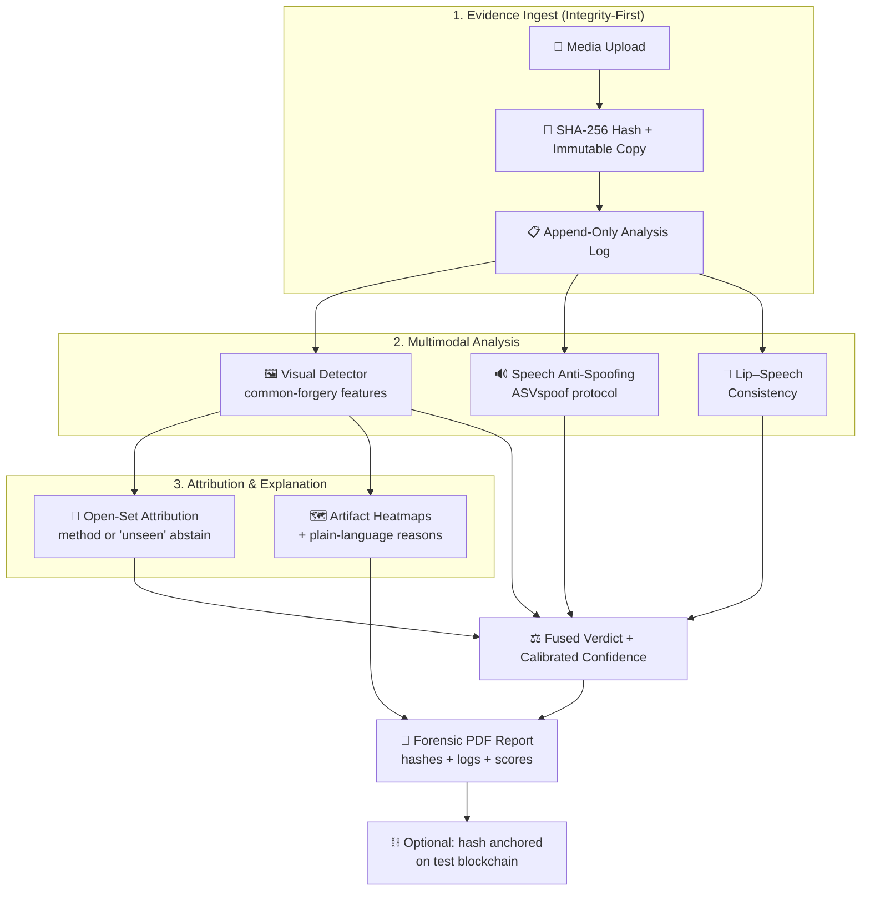
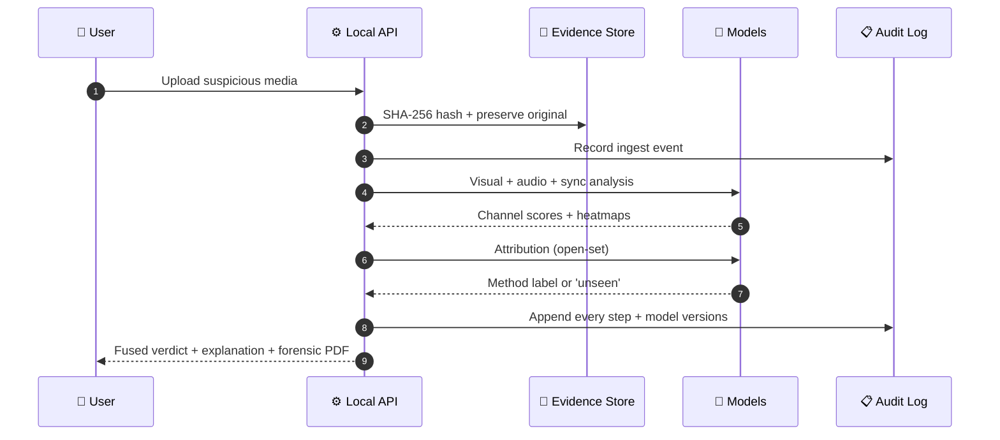

<div align="center">

  

  <br/>
  <br/>

  <h1>🔍 DeepWatch — Unified Deepfake Forensics & Attribution Platform</h1>

  <p>
    <strong>Multimodal AI forensic lab that detects manipulated media, attributes the generation method, explains the evidence, and issues integrity-protected forensic reports</strong>
  </p>

  <p>
    <a href="https://github.com/SyedAynan/Mini-Project/actions"></a>
    <a href="https://github.com/SyedAynan/Mini-Project"></a>
    <a href="https://github.com/SyedAynan/Mini-Project/blob/main/LICENSE"></a>
    
    
    
  </p>

  <p>
    <a href="#-the-problem">Problem</a> &bull;
    <a href="#-what-deepwatch-does">What It Does</a> &bull;
    <a href="#-architecture--pipeline">Architecture</a> &bull;
    <a href="#-base-papers--novelty">Base Papers</a> &bull;
    <a href="#-tech-stack">Tech Stack</a> &bull;
    <a href="#-docs-first-architecture">Docs</a> &bull;
    <a href="#-roadmap">Roadmap</a>
  </p>

</div>

<br/>

---

> [!IMPORTANT]
> **Docs-First Architecture:** This repository enforces strict documentation discipline (`PRD.md`, `TECHSPEC.md`, `ARCHITECTURE.md`, `MEMORY.md`). All system design changes are captured in specification documents before implementation. The full research proposal is at [`docs/DeepWatch-Report.pdf`](docs/DeepWatch-Report.pdf).

---

## ⚠️ The Problem

Generative AI can now fabricate convincing faces, voices, and videos in minutes — and it is being used for real crime: voice-clone scam calls, fabricated videos of private individuals, and unverifiable digital "evidence." Yet today's research tools each solve only a fragment of the problem:

- **Detectors** output a bare probability — no explanation, trained on clean lab data
- **Attribution methods** identify which tool made a fake — but only for faces
- **Speech anti-spoofing** checks the audio — but is never fused with video
- **No published system** produces evidence a victim can hand to police or a platform

DeepWatch closes that gap: **one platform that detects, attributes, explains, and documents.**

<br/>

## 🔍 What DeepWatch Does

| Component | Feature | Answers base-paper gap |
| :--- | :--- | :--- |
| **D1** | Visual deepfake detection (common-forgery features, after UCF) | Cross-dataset degradation + no explanation |
| **D2** | Audio–video fusion (speech anti-spoofing + lip-sync check) | Unimodal audio/visual evaluation |
| **D3** | Open-set generation-method attribution with abstention | Face-only, closed-set attribution |
| **D4** | Explainable evidence — artifact heatmaps + plain-language reasons | Opaque bare-score outputs |
| **D5** | Forensic PDF report — SHA-256 hashed, integrity-logged, optional blockchain anchor | No usable evidence output |

> [!NOTE]
> **Honest framing:** DeepWatch outputs are *indicators supporting an assessment*, not definitive proof. All claims are evaluated against the base papers' published benchmarks.

<br/>

## 🏗️ Architecture & Pipeline

### 1. Forensic Analysis Pipeline



### 2. Sequence Flow



<br/>

## 📄 Base Papers & Novelty

| Base Paper | Venue | Contribution | Limitation DeepWatch addresses |
| :--- | :--- | :--- | :--- |
| **UCF** — Yan et al. | IEEE/CVF ICCV 2023 | Common-forgery-feature detection; 0.996 in-dataset AUC | 0.828 cross-dataset AUC; needs per-method labels; no explanation |
| **Up-sampling artifacts** — Tan et al. | IEEE/CVF CVPR 2024 | Detects CNN-generator up-sampling artifacts | Tied to CNN artifact classes; unaddressed generator families |
| **OW-DFA / CPL** — Sun et al. | IEEE/CVF ICCV 2023 | Open-world attribution of unseen forgery methods | Face-only; limited unseen-method accuracy |
| **ASVspoof 2021** — Liu et al. | IEEE/ACM TASLP 2023 | Standard speech anti-spoofing benchmark | Audio-only; never fused with visual analysis |

**Delta:** detection + attribution + explanation + integrity-protected reporting in one pipeline — a combination absent from the reviewed literature (scoped claim, verified in `docs/RESEARCH.md`).

<br/>

## 🔬 Forensic Integrity

- 🔐 **SHA-256** hashing of every submitted file before analysis
- 🗄️ **Original media preserved** unmodified; all processing on copies
- 📋 **Append-only analysis log** — every step, model version, and parameter
- ⚖️ **False positives and false negatives reported separately** — they cost differently in the real world
- 🔁 **Reproducible** — code, configs, model hashes, and eval scripts released
- 🧾 Optional **test-blockchain hash anchoring** (tamper evidence, not truth claims)

<br/>

## 🛠️ Tech Stack

- **ML & Analysis:**    `timm` `librosa` `torchaudio` `ffmpeg`
- **Baseline Benchmark:** [DeepfakeBench](https://github.com/SCLBD/DeepfakeBench) (NeurIPS 2023 — implements UCF + eval protocols)
- **API & UI:** FastAPI · minimal HTML/JS frontend
- **Forensics:** `hashlib` (SHA-256) · SQLite audit log · ReportLab/WeasyPrint (PDF)
- **Tooling:** uv · pytest · Git & GitHub

<br/>

## 📚 Docs-First Architecture

| Document | Focus |
| :--- | :--- |
| [`docs/PRD.md`](docs/PRD.md) | Product requirements — D1–D5 features, FR-01..06, NFR-01..06 |
| [`docs/DeepWatch-Report.pdf`](docs/DeepWatch-Report.pdf) | 2-page research proposal (base papers, gaps, innovations) |
| [`docs/ARCHITECTURE.md`](docs/ARCHITECTURE.md) | Forensic pipeline, module boundaries, security model |
| [`docs/TECHSPEC.md`](docs/TECHSPEC.md) | Stack, datasets, evaluation plan |
| [`docs/RESEARCH.md`](docs/RESEARCH.md) | Domain scans, base-paper verification, gap analysis |
| [`docs/IMPLEMENTATIONPLAN.md`](docs/IMPLEMENTATIONPLAN.md) | Phase 1–4 tasks with acceptance criteria |
| [`docs/TRACKER.md`](docs/TRACKER.md) | Live task progress |
| [`docs/MEMORY.md`](docs/MEMORY.md) | Sprint log and current state |

<br/>

## 💻 Getting Started

```bash
# 1. Clone
git clone https://github.com/SyedAynan/Mini-Project.git
cd Mini-Project

# 2. Inspect the spec
head -n 40 docs/PRD.md

# 3. Environment (once Phase 1 scaffold lands)
uv sync
uv run pytest
```

<br/>

## 🗺️ Roadmap

- [x] **Phase 0:** Direction, IEEE base papers, gap analysis, PRD, stack, proposal PDF
- [ ] **Phase 1:** Scaffold + baseline detector on a public benchmark (via DeepfakeBench)
- [ ] **Phase 2:** Audio anti-spoofing, lip–speech sync, open-set attribution, fusion
- [ ] **Phase 3:** Explainability heatmaps, forensic PDF, audit log, web UI
- [ ] **Phase 4:** Honest benchmarking vs baselines (FP/FN separated), demo, docs polish

> ⚠️ **Pending user actions:** IEEE Xplore access check for the 4 base papers; FaceForensics++ download agreement (Google form) submitted.

<br/>

## 📄 License

Distributed under the **MIT License** for project code. Note: DeepfakeBench baseline code is CC BY-NC-4.0 (non-commercial). See [`LICENSE`](LICENSE).

<br/>

## 👨‍💻 Author

<div align="center">

  <h3>Syed Ayan</h3>
  <p><strong>Full Stack Developer &bull; Web3 Engineer &bull; System Architect</strong></p>

  <a href="https://github.com/SyedAynan">
    
  </a>
  <a href="https://vercel.com/elight1">
    
  </a>

</div>
